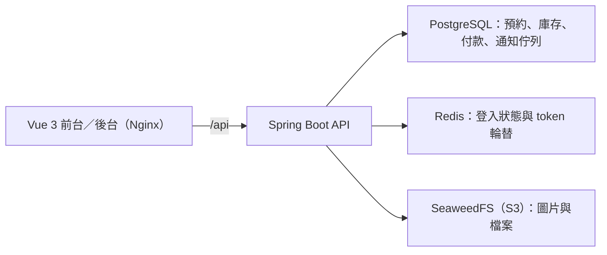

# 發呆亭露營區官網與訂位平台

*A campsite website and operations platform for reservations, inventory, payments, and guest stays.*

發呆亭是以單一露營區為對象的全端作品，提供旅客瀏覽營位、查詢可售日期、預約與查單，也讓營區管理員及現場人員處理日常營運。
專案將逐晚庫存、付款狀態、入住／退房與操作歷程串接在同一套流程，處理超賣、重複付款通知及多人同時修改訂單等問題。

## 展示

- [線上沙盒 camp.jackteng.dev](https://camp.jackteng.dev)：可直接預約營位、用訂單編號＋電話查單並模擬付款，也能進入後台（`/admin/login`）處理確認、入住／退房與退款審核。訂單皆為虛構，每天 04:20（台北時間）自動重置。
  - 管理員：`admin001` / `camp-demo-admin`；現場人員：`staff001` / `camp-demo-staff`
- 沙盒與正式部署使用相同版本；為了讓每位訪客都能使用，停用帳號／密碼異動、刪除營區資料、金流設定修改與檔案上傳。
- [作品集](https://jackteng.dev)。完整預約與後台操作也可在本機隔離環境依[展示流程](DEMO_WALKTHROUGH.md)試跑。

## 主要功能

- 官網首頁、營位介紹、營區地圖、最新消息、FAQ 與預約須知。
- 依日期報價與逐晚庫存檢查、租借品加選、預約送出，以及訂單編號／聯絡電話查單。
- 營區、營位、價格方案、每日庫存與租借品管理；未付款預約到期取消並釋放庫存。
- ADMIN／STAFF 固定角色與員工帳號管理；住宿名單、日曆、CSV 匯出及入住／退房登記。
- mock 付款、付款紀錄與人工補登、晚到款核對、退款申請／審核／模擬及系統外退款完成登記。
- 通知佇列、模擬處理、失敗重試與歷程查詢；後台通知告警、保留唯讀試算及備份狀態觀測。
- LINE webhook 與身分核驗／逐筆訂單綁定 API；另有獨立 LINE／LIFF 原型，尚未在展示伺服器啟用。

## 技術架構

| 層 | 技術 |
| --- | --- |
| 前端 | Vue 3、Composition API、TypeScript、Vite、Pinia、Vue Router、Element Plus |
| API 與授權 | Java 25、Spring Boot 4、Spring Security、JWT、MyBatis |
| 資料與通知佇列 | PostgreSQL；通知與業務資料同庫交易 |
| 登入狀態與物件儲存 | Redis、SeaweedFS（S3 相容） |
| 執行與交付 | Docker Compose、Nginx、GitHub Actions、私人 GHCR |
| LINE 原型（可選） | Node.js／Express、Vue 3／Vite、LINE Messaging API／LIFF |

以下為完整 Docker 堆疊的主要執行元件；LINE 原型另行啟動。



## 工程重點

- **併發庫存與狀態保護**：PostgreSQL 條件式 UPSERT 保留逐晚庫存、依固定順序鎖定租借品；付款、取消與逾時共用訂單鎖，操作版本阻止舊表單覆寫。[期限與庫存設計](BOOKING_HOLDS.md)
- **付款與退款一致性**：重複付款確認不重複入帳；綠界 callback 核對簽章、商家與金額，晚到款轉人工核對。退款以交易鎖、額度保留及識別碼避免超退與重複扣帳。[退款與對帳](PAYMENT_REFUNDS.md)
- **可追蹤的通知重試**：業務資料與 durable outbox 同交易提交，以唯一事件鍵去重；SKIP LOCKED、租約與退避控制領取。SMTP 結果不明時停下人工核對，不宣稱外部 exactly-once。[通知佇列](NOTIFICATION_QUEUE.md)
- **登入與授權邊界**：HttpOnly／Secure cookie、CSRF 驗證及 Redis 原子 refresh token 輪替；管理端重新核對資料庫角色與停用狀態，LINE 以官方 ID token 驗證身分。[身分安全](AUTH_LINE_SECURITY.md)、[角色設計](CAMP_PERMISSIONS.md)
- **可驗證的備份**：以 pg_dump custom format、同快照資料指紋與 SHA-256 保存備份，在新建無網路容器還原並核對結構、中文與業務關聯，避免覆寫既有資料庫。[備份與隔離還原](BACKUP_RESTORE.md)

## 品質與交付

- [GitHub Actions `verify`](.github/workflows/showcase-verify.yml) 在 PR 與 main push 執行：前端 `vue-tsc`／Vite build、後端 `mvn verify`，並使用可拋棄的 PostgreSQL／Redis 整合測試環境；測試失敗或非預期略過會阻擋交付。
- [2026-10-06 驗證紀錄](docs/verification/demo-closeout-2026-10-06.json)記載：後端 189 項、HTTP 21 項、Chromium 14 項通過，前端型別檢查與 production build 成功。這些是文件中的歷史結果，並非本次重跑或目前部署版本的測試數量。
- 交付流程為 PR → `verify` 通過並合併 → main CI 通過 → [發布私人 GHCR 映像](.github/workflows/homelab-release.yml) → 自架伺服器以 pull-based CD 自動拉取部署；映像以 digest 與來源版本核對。

## 本機啟動

完整開發堆疊只需先備妥 Docker。首次啟動在專案根目錄執行：

```bash
cp .env.example .env
# 編輯 .env：設定至少 32 字元的私有隨機 JWT_SECRET；本機 HTTP 設 AUTH_COOKIE_SECURE=false
docker compose -f docker-compose.yml -f docker-compose.dev.yml up --build
```

前台：`http://localhost:5173/`；後台：`http://localhost:5173/admin/login`。
已有 `.env` 時沿用原檔；已有資料庫時先備份並依文件補齊 migration，不刪除 volume 重建。
帳號初始化、Java／Node 分開啟動及升級步驟見[本機環境設定](NEW_MACHINE_SETUP.md)與[登入設定](CAMP_PERMISSIONS.md)。

## 已知限制

- 定位為展示與隔離試跑案例，尚未完成正式營運驗收；目前以單一營區流程為主。
- 真實 LINE Pay／綠界商家驗收與旅客付款授權仍待完成；mock 不扣款，人工退款完成僅登記系統外處理結果，沒有自動銀行轉帳。
- LINE bot／身分整合未在展示伺服器啟用；獨立呼叫端更新與真實手機驗收待完成。通知 worker 與真實寄信預設關閉，模擬不代表送達。
- 通知保留僅唯讀試算，尚無清理排程；正式圖片／條款、完整手機體驗、營運報表及大資料壓測仍待補齊。
- 備份工具文件的隔離演練以 PostgreSQL 17 為基準，Compose 使用 PostgreSQL 18；完整復原仍需依部署環境另行驗收。

## 文件

- [展示操作與驗收界線](DEMO_WALKTHROUGH.md)
- [本機環境設定](NEW_MACHINE_SETUP.md)
- [資料表結構](SCHEMA.md)
- [入住／退房規則](BOOKING_STAYS.md)
- [金流設定與驗收條件](PAYMENT_SANDBOX_SETUP.md)
- [LINE 整合原型](fadaiting-line/README.md)
- [備份觀測](BACKUP_OBSERVABILITY.md)
- [開發紀錄（原 README 封存）](docs/DEV_LOG.md)
